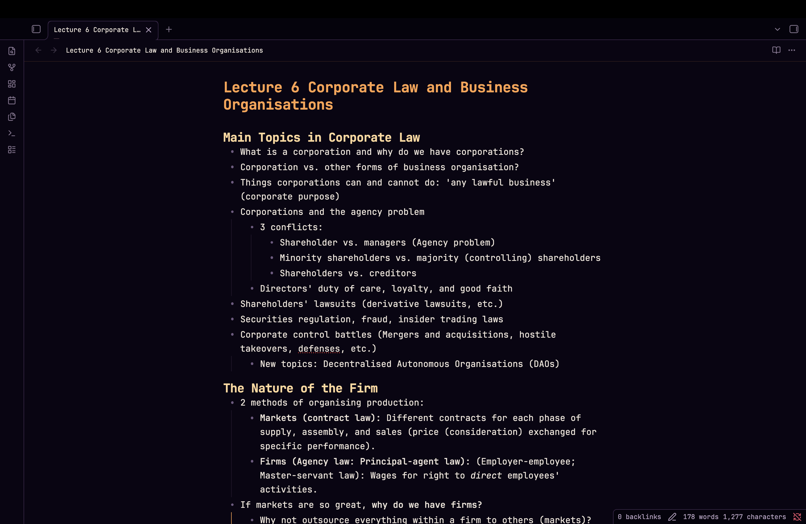

# Moon City

A Halloween theme for Obsidian: aubergine night, ember city-light, a grinning moon
over the river. Dark mode is the point — light mode is the morning after.

## Palette

| | dark | light |
|---|---|---|
| ground | `#0a0513` | `#faf5ec` |
| text | `#ece2d8` | `#2a1b2e` |
| accent (ember) | `#ffa04a` | `#d4701a` |
| moon | `#ffd79a` | `#b4702a` |
| orchid | `#b45ccf` | `#8e3bab` |
| bold | `#ffd79a` | `#b4702a` |
| blood | `#b01f36` | `#9e1a2f` |

Headings run ember → moon → orchid. Links, checkboxes, the active tab underline
and the explorer spine all use the ember accent, so a focused thing is always
the warmest thing on screen.

## Fonts

Everything — body, interface and code — is set in **JetBrainsMono Nerd Font Mono**,
with ui-monospace/SF Mono/Menlo as fallbacks. It is a terminal theme that happens
to be in Obsidian, so it uses a terminal face throughout.

## Install

**Community themes:** Settings → Appearance → Themes → Manage → search *Moon City*.

**Manual:** copy this folder into `<vault>/.obsidian/themes/Moon City/`, then pick it
in Settings → Appearance.

## License

MIT
